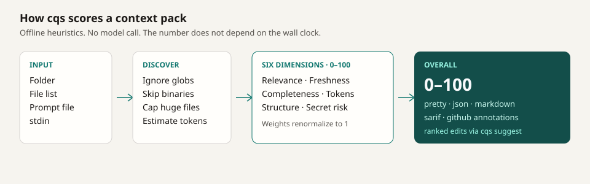
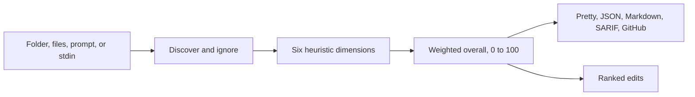

# context-quality (`cqs`)

[](https://github.com/tz0127302-cell/context-quality/blob/main/LICENSE)
[](https://nodejs.org)
[](https://github.com/tz0127302-cell/context-quality#scoring-rubric)
[](https://github.com/tz0127302-cell/context-quality/actions/workflows/ci.yml)

Multi-agent coding is the default this week: GitHub Copilot's Gemini 4 Hydrogen workflows, JetBrains Air, and coordinated agent swarms all live or die by the context you pack.
`cqs` scores that pack on your machine, with no API key and no model call, so you can cut noise, refresh stale docs, and keep secrets out before a swarm reads them.

> **Unofficial.** context-quality is an independent open-source tool. Atlassian has described a Context Quality Score for enterprise AI; this project is not that product, not an official CQS implementation, and not affiliated with Atlassian, GitHub, JetBrains, or any model provider. The industry moment is the motivation. The score is six documented heuristics, run locally.

## 30-second demo

```bash
npm install
npm run demo
npm run cqs -- suggest examples/fixture-pack
npm run cqs -- score examples/fixture-pack --json --threshold 60
```

`examples/fixture-pack` is a tiny retry helper with a lockfile, a duplicate, a stale doc, a broken link, a repeated banner, and a synthetic credential. It scores **89 / 100 (good)**. A representative report:

```text
cqs 0.1.0  context quality

Overall  89 / 100  good
██████████████████░░
examples/fixture-pack  ·  pack
13 files  ·  1,255 tokens  ·  4.9 KB

Dimension          Score  Weight
Relevance             89     20%  █████████░
Freshness             92     15%  █████████░
Completeness          92     20%  █████████░
Token efficiency      92     15%  █████████░
Structure            100     15%  ██████████
Secret risk           65     15%  ███████░░░

Findings
  error    secrets        .env:2
           Possible GitHub personal access token. Value redacted.
  warning  relevance      package-lock.json:1
           Lockfile package-lock.json is dependency metadata.
  warning  freshness      docs/legacy.md:1
           Document is 518 days behind the newest code (2025-06-01 vs 2026-11-01).

Suggestions
  1. +4  Remove the credential-like value in .env
  2. +2  Fix the broken link in docs/legacy.md
  3. +2  Remove .env from the context pack
```

The value on `.env:2` is synthetic. It never appears in the report. `examples/fixture-pack.expected.json` pins 89 and each dimension; CI fails if the fixture drifts.

After `npm run build`, run `node dist/cli.js` or `./node_modules/.bin/cqs` from this checkout. `cqs` is not published to the npm registry, so `npx cqs` and `npm install cqs` will not install this project.

## Install

Node.js 20 or newer. Clone the git repository. Scoring itself does not call the network.

```bash
git clone https://github.com/tz0127302-cell/context-quality.git
cd context-quality
npm install
npm test
npm run build
node dist/cli.js --help
```

The package name and the executable are both `cqs`. There is no npm release yet.

```bash
# a directory, a prompt file, a list, or stdin
cqs score ./context
cqs score prompt.md --format markdown
cqs score --list files.txt --json
cat prompt.md | cqs score --stdin
cqs suggest ./context --limit 5
cqs init
```

## How a pack is scored





Discovery skips `.git` always, and by default skips `node_modules`, `dist`, `build`, coverage, and common binary types. A file you pass by path is still scored. Text is estimated at about 4 characters per token. Reports omit timestamps on purpose, and freshness compares dates inside the pack rather than today's date, so a git checkout does not look stale just because it was cloned.

### Scoring rubric

| Dimension | Default weight | What a high score means | What lowers it |
| --- | ---: | --- | --- |
| Relevance | 20% | Most bytes are source, docs, or config an agent can use | Lockfiles, duplicates, vendored trees, minified bundles, binaries, oversized files |
| Freshness | 15% | Docs and code carry nearby embedded dates | A doc dated more than `staleDays` (default 180) behind the newest code. Extra stale docs cost 8 points, capped at 24 |
| Completeness | 20% | A multi-file pack has a README, resolving links, and a type or API signal next to implementations | Missing README (−30), each broken relative link (−8, cap 40), missing interface signal (−20), broken relative imports (−6, cap 24), empty files (−4, cap 12) |
| Token efficiency | 15% | Little repeated text, under the token budget (default 80,000) | Lines of 30+ characters repeated across 3+ files. Overflow past the budget scales the score down, at most by half |
| Structure | 15% | README with headings and a code sample, an entrypoint, API docs, a manifest or `src/` layout, an agent guide | Points are additive and capped at 100. A single prompt uses a heading-and-instruction rubric instead |
| Secret risk | 15% | No credential-shaped lines and no live env file | Each pattern −25. An unsafe `.env` file −10. Floor 0. Values are never printed |

Weights are relative. `20, 15, 20, 15, 15, 15` and `0.20, 0.15, …` normalize to the same score.

**Overall** = round(sum of dimension score × normalized weight).

Relevance uses `100 × (1 − 0.7 × noiseBytes/totalBytes − 0.3 × noiseFiles/totalFiles)`.

A single file, including stdin, does not need a README. A directory or a file list does.

| Grade | Score |
| --- | --- |
| excellent | 90–100 |
| good | 75–89 |
| fair | 60–74 |
| poor | 40–59 |
| critical | 0–39 |

### Exit codes

| Code | Meaning |
| ---: | --- |
| 0 | The score was computed and met the threshold |
| 1 | Below `--threshold` / `--fail-under`, or a secret error with `--fail-on-secrets` |
| 2 | Invalid usage |
| 3 | Config or filesystem error, including an unknown path |

The default threshold is 0, except that an empty pack scores 0 and fails. In CI, pass `--threshold 60` or set `threshold` in `.cqs.json`.

### Reports

| `--format` | stdout |
| --- | --- |
| `pretty` (default) | The table above. `--quiet` prints only the number |
| `json` | The full report. `--json` is the same switch |
| `markdown` | A pull-request-ready writeup |
| `sarif` | SARIF 2.1.0. Findings carry no code snippets |
| `github` | `::error` / `::warning` / `::notice` annotations, plus `CQS_SCORE=` |

`--markdown-out` and `--sarif-out` write those files in addition to stdout. In GitHub Actions, `--format github` also appends the Markdown report to the step summary and writes `score`, `grade`, and `passed` to `GITHUB_OUTPUT`.

## Suggestions

`cqs suggest` prints ranked edits. Each line is a concrete change: which file to delete, which link to retarget, which date to refresh. `estimatedGain` is an overall-point estimate, scaled so a dimension's suggestions cannot promise more points than that dimension has left. It is a guide, not a second score.

## Configuration

`cqs init` writes `.cqs.json`. `cqs init --force` replaces it. On later runs, `cqs` walks from the working directory to the git root and uses the first `.cqs.json` or `cqs.config.json`.

```json
{
  "version": 1,
  "ignore": ["**/package-lock.json", "**/yarn.lock"],
  "useDefaultIgnores": true,
  "weights": {
    "relevance": 0.2,
    "freshness": 0.15,
    "completeness": 0.2,
    "tokens": 0.15,
    "structure": 0.15,
    "secrets": 0.15
  },
  "tokenBudget": 80000,
  "staleDays": 180,
  "threshold": 60,
  "maxFileBytes": 512000,
  "maxFiles": 20000,
  "failOnSecrets": false,
  "llm": { "enabled": false }
}
```

`ignore` adds globs. It does not replace the defaults unless `useDefaultIgnores` is false. The shape is described in [`schema/cqs.config.schema.json`](schema/cqs.config.schema.json).

`llm.enabled` defaults to false. The CLI never runs `llm.command` and never calls a model. Library callers can pass an `llmReviewer`; notes are attached, credential-shaped notes are redacted, and the numeric score does not change.

## GitHub Action

The action runs the CLI from `dist/cli.js`. Scoring stays offline. Pull request comments are off unless you set `comment: 'true'`.

```yaml
name: Context quality
on:
  pull_request:
permissions:
  contents: read
jobs:
  cqs:
    runs-on: ubuntu-latest
    steps:
      - uses: actions/checkout@v4
      - uses: tz0127302-cell/context-quality@main
        id: cqs
        with:
          path: .
          threshold: '60'
          fail-on-secrets: 'false'
      - name: Show the score
        run: echo "cqs ${{ steps.cqs.outputs.score }} (${{ steps.cqs.outputs.grade }})"
```

Source: [https://github.com/tz0127302-cell/context-quality](https://github.com/tz0127302-cell/context-quality). Inside this repo, `uses: ./` works the same way. A ready-made workflow lives at [`.github/workflows/score.yml`](.github/workflows/score.yml). To post one comment marked `<!-- cqs-report -->`, set `comment: 'true'` and grant `pull-requests: write`. That step does not run with the default.

| Input | Default | Purpose |
| --- | --- | --- |
| `path` | `.` | File or directory to score |
| `threshold` | `60` | Fail when the overall score is lower |
| `config` | empty | Explicit config path |
| `ignore` | empty | Extra globs, separated by newlines |
| `markdown` | `cqs-report.md` | Markdown report path. Empty skips it |
| `sarif` | `cqs.sarif` | SARIF path. Empty skips it. Upload it with `github/codeql-action/upload-sarif` if you want code scanning |
| `comment` | `false` | Opt in to create or update one pull-request comment marked `<!-- cqs-report -->` |
| `fail-on-secrets` | `false` | Also fail when a credential pattern is present |
| `token` | `github.token` | Used only for the comment |

The job fails when the score is below the threshold. With `comment: 'true'`, the comment step runs before that failure so a failing pack can still leave the report on the pull request. The runner needs Node.js 20 or newer, which GitHub-hosted runners provide. If `dist/cli.js` is missing, the action installs and builds this repo.

## Library

```ts
import { scoreContext } from 'cqs';

const report = await scoreContext({ paths: ['examples/fixture-pack'] });
console.log(report.overall, report.suggestions[0]?.title);
```

Pass `files` instead of `paths` to score an in-memory pack. Pass `config` from `resolveConfig` to override weights. The public types are exported from the package entry.

## Development

```bash
npm install
npm test
npm run typecheck
npm run build
```

See [CONTRIBUTING.md](CONTRIBUTING.md). The fixture and its intentional defects are described in [examples/README.md](examples/README.md).

## Limitations

These checks are heuristics, not a judgment of whether the prose is true or the task is well specified.

- Semantic relevance ("does this file help this task?") is not scored. A human, or a future reviewer hook, has to answer that.
- Secret detection is pattern-based. Novel formats pass. Documentation that copies a real pattern is flagged. A variable named `token` is not treated as a secret; `api_key=…`, `password=…`, uppercase `TOKEN=…`, and live `.env` files are.
- Freshness trusts the latest `YYYY-MM-DD` near `Last updated`, `updated`, `modified`, `date`, or `@modified`. A changelog full of dates uses the newest one.
- Relative imports are resolved for JavaScript and TypeScript. Other languages contribute to structure and freshness, not to the import check.
- Markdown reference-style links are not followed. Inline links and images are.

## License

[MIT](LICENSE).
